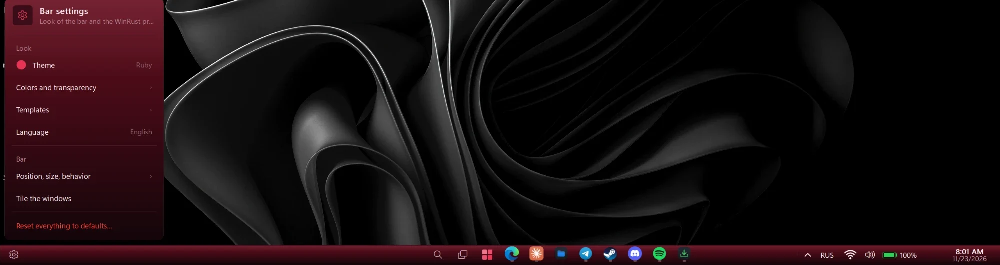
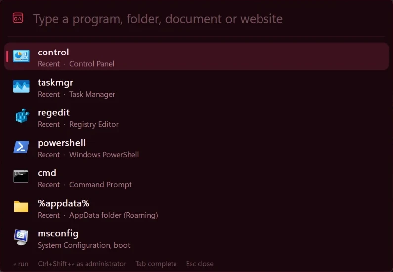
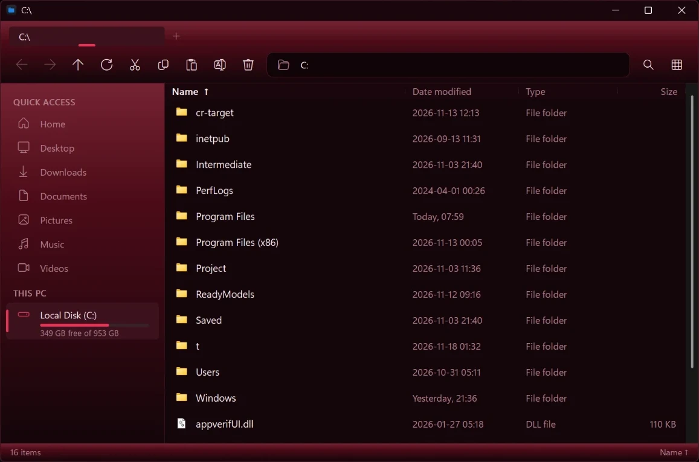

<p align="center"></p>

<h1 align="center">WinRust</h1>

<p align="center"><b>Tu Windows, sin lo que sobra.</b><br>La barra de tareas, el Explorador de archivos, la búsqueda de archivos y el Administrador de tareas rehechos en Rust: nativos, diminutos y rápidos.</p>

<p align="center">
  <a href="https://github.com/Lemxy/WinRust/releases/latest"><b>⬇ Descargar WinRust.exe</b></a> ·
  <a href="#instalar">Instalar</a> ·
  <a href="#qué-se-instala">Qué incluye</a> ·
  <a href="#comunidad">Comunidad</a>
</p>

<p align="center"><a href="README.md">English</a> | <a href="README.ru.md">Русский</a> | <a href="README.ja.md">日本語</a> | <a href="README.pt-BR.md">Português (Brasil)</a> | <a href="README.zh.md">简体中文</a> | <b>Español</b></p>



> **Lee esto primero.** WinRust apaga la Búsqueda de Windows, oculta la barra de tareas y puede quitarle al Explorador el papel de shell. El exe no está firmado, así que SmartScreen te avisará. Antes de instalar se crea un punto de restauración, pero pruébalo primero en una máquina de repuesto o en una VM.

## Por qué WinRust

- **Rápido.** Una ventana de carpeta se abre en 60 ms en lugar de 420 ms; buscar en todo el disco C: tarda 45 ms ([mediciones](#rendimiento)).
- **Ligero.** Todo el shell ocupa 46 MB de memoria; explorer.exe ocupaba 366 MB.
- **Nativo.** Programas Win32 pequeños: sin .NET, sin Electron.
- **Reversible.** Cada valor se guarda antes de cambiarlo y se restaura al desinstalar. Un botón lo quita todo.
- **A tu gusto.** Ocho estilos (Rubí, Terminal, Dock flotante, Windows 98 y más), cualquier color, la barra en cualquier borde, English, Русский, 日本語, Português, 简体中文 o Español.

## Cómo se ve

| Ejecutar (Win+R) | Gestor de archivos |
|---|---|
|  |  |

**Administrador de tareas** (interfaz en ruso)


## Instalar

1. Descarga `WinRust.exe` de la [última versión](https://github.com/Lemxy/WinRust/releases/latest) (Windows 10/11, x64).
2. Ejecútalo como administrador.
3. Elige **Rápida (recomendada)** y pulsa **Instalar**: búsqueda, Administrador de tareas, la barra, Configuración, análisis de disco y el visor de fotos, sin quitar nada y dejando el Explorador en su sitio. O elige **Personalizada (avanzada)** para marcar tú los componentes, incluido `rust-explorer` (el gestor de archivos; reemplazar el shell del Explorador de Windows es el interruptor **Reemplazar el Explorador** del engranaje de la fila de la topbar) y los extras. Se instalan en el orden correcto; uno que falle o se omita no detiene a los demás, y la última página muestra cada componente con su resultado.

La Búsqueda de Windows es opcional: en un Windows recortado (por ejemplo, una imagen LTSC sin el servicio de Búsqueda de Windows) ese paso se omite con una advertencia en lugar de hacer fallar la instalación.

Si el UAC pide la contraseña de **otro administrador**, la configuración por usuario (entradas de inicio, tareas programadas, perfil de PowerShell, permisos de búsqueda) sigue yendo al usuario que inició sesión, no al administrador que escribiste. Si el instalador no puede saber quién es, se detiene antes de cambiar nada.

**Actualizaciones automáticas:** tras la primera instalación, una tarea programada `WinRust-update` (se ejecuta como SYSTEM, sin aviso de UAC) revisa la última versión al arrancar y una vez al día. Descarga el nuevo `WinRust.exe` (y cualquier programa que una versión publique por separado) y verifica cada archivo contra un manifiesto firmado con la clave del proyecto (una versión alterada o sin firma se rechaza); después, el nuevo `WinRust.exe` reemplaza los programas instalados que difieren de los que lleva dentro. Solo se reemplazan archivos que ya están instalados. Un programa en marcha pasa a la nueva versión la próxima vez que se inicia (al iniciar sesión o al reiniciar). Registro: `%ProgramData%\plugin-launcher\install.log` (líneas `autoupdate:`). Para desactivarlas, deshabilita la tarea `WinRust-update` en el Programador de tareas; **Quitar WinRust** la elimina.

**Actualización manual:** descarga el nuevo `WinRust.exe` de la página de versiones, ejecútalo como administrador y pulsa **Actualizar** en la tarjeta Rápida (reinstala lo instalado y agrega lo que falta), o usa Personalizada. Un `rust-explorer` ya instalado sigue marcado. Tu configuración y los valores originales de Windows guardados se conservan.

El instalador está en inglés. En su esquina hay una lista de idiomas: English, Русский, 日本語, Português (Brasil), 简体中文, Español; la misma lista está en el engranaje de la barra (**Configuración de la barra → Idioma**), y rust-settings la tiene en su página Personalización (**Idioma de la interfaz**). La elección se guarda en `%ProgramData%\WinRust\lang.txt` (`en`, `ru`, `ja`, `pt`, `zh`, `es`); todas las ventanas abiertas de WinRust cambian al momento. Un texto que aún no está traducido se muestra en inglés.

## Quitar

- **Quitar WinRust** en la primera página del instalador lo deshace todo: vuelven la Búsqueda de Windows, la barra de tareas, el Explorador y los servicios.
- Un plugin cada vez: `plugin-launcher uninstall <plugin>` (consulta [Línea de comandos](#línea-de-comandos)).
- **Si la pantalla queda sin barra de tareas o sin escritorio:** pulsa Ctrl+Alt+Supr → Administrador de tareas → Ejecutar nueva tarea → `explorer.exe`, luego abre el instalador y pulsa Quitar WinRust.

Al desinstalar, `rust-explorer` restaura los valores de inicio de los servicios y el umbral de agrupación de svchost guardados antes de instalar. Las instalaciones antiguas sin esas copias conservan sus valores actuales y muestran una advertencia.

## Qué se instala

| Plugin | Qué obtienes | Qué cambia en Windows |
|---|---|---|
| **rust-search** | Búsqueda de archivos en todas las unidades NTFS, Alt+Espacio o Win+S (cualquiera de los dos se puede apagar en el engranaje de su fila). Con la topbar, Win+R abre su modo Ejecutar: historial, completado de carpetas (Tab), Ctrl+Shift+Enter ejecuta como administrador | Desactiva el servicio Búsqueda de Windows, bloquea SearchHost.exe (la ventana de búsqueda de Windows 11; la de Windows 10 se deja como está, Win+S solo pasa a abrir rust-search) y oculta el cuadro de búsqueda de la barra de tareas |
| **rtaskmgr-win32** | Administrador de tareas (Ctrl+Shift+Esc lo abre) | `taskmgr.exe` se redirige a él (el archivo del sistema no se toca). También instala el limpiador de disco **rs-du**. La página **Velocidad** tiene interruptores opcionales y reversibles: perfiles Juego / Trabajo (detienen servicios en segundo plano, cierran lanzadores o apps de sincronización y luego los vuelven a iniciar), vaciar la caché de memoria en espera (ahora, o automáticamente mientras corre la topbar), bloquear los procesos del menú Inicio de Windows, los widgets y Vínculo móvil, un único `winget upgrade` semanal en lugar de los actualizadores de terceros, exclusiones de Defender para cachés de compilación y bibliotecas de juegos, NTFS más rápido (sin hora de último acceso ni nombres 8.3) y un archivo hosts que bloquea anuncios. **Inicio** también muestra las tareas de inicio de sesión/arranque y los servicios de terceros con inicio automático, con cuánto retrasó cada uno los últimos arranques (el propio registro de arranque de Windows). **Qué va lento** muestra el tiempo de los controladores (DPC/interrupciones), ventanas colgadas, disco lento y tiempos de arranque. Al desinstalar todo vuelve atrás |
| **topbar** | Una barra inferior al estilo de Windows 11: ventanas, reloj, volumen, menús | Oculta la barra de tareas original. También instala **reshell** (atajos: Win+Ctrl+1/2/3 y Win+\` cambian de escritorio (Win+1..9 abren los botones de apps de la barra), Win+D muestra el escritorio, Win+I abre Configuración, Win+E el gestor de archivos; devuelve la barra de tareas si la barra se cae), **rs-du** y, solo si lo activas en el engranaje de su fila en el instalador, un bloque en tu perfil de PowerShell (`zoxide`, `grep`=rg, `ll`=eza, `cat`=bat; no hace nada si faltan). Ese engranaje también tiene la apariencia: botones centrados (lo predeterminado en Windows 11; en Windows 10 empiezan a la izquierda), todos los íconos de la bandeja en la barra, una barra translúcida y el desenfoque detrás de ella. El menú del engranaje de la propia barra tiene páginas cortas: Tema, Colores y transparencia (cualquier color de la barra y de las ventanas de WinRust, la opacidad de la barra, el desenfoque detrás de ella), Plantillas (guarda tus propias apariencias y cambia entre ellas), la barra (borde inferior / izquierdo / derecho, tamaño, ocultar automáticamente, botones a la izquierda como en Windows 10) y Restablecer todo a los valores predeterminados |
| **rust-explorer** | Un gestor de archivos con pestañas, y el escritorio | Las carpetas y unidades se abren en él; el Explorador sigue siendo el shell. Con **Reemplazar el Explorador** (el engranaje de la fila de la topbar en el instalador, o `--shell`) **el Explorador deja de ser el shell** y la topbar viene con él (el Explorador vuelve solo si la topbar falla); entonces, la primera vez, ajusta el inicio de InventorySvc, lfsvc y DoSvc, y el umbral de agrupación de svchost, cuando sus valores se pueden respaldar. Su propio copiador (varios archivos a la vez en SSD, sin búfer para archivos grandes, progreso en la barra de estado) y en el clic derecho **Comprimir en ZIP** (todos los núcleos) / **Extraer aquí** (ZIP y 7z), con nuestro propio motor ZIP; un `.zip` se abre como una carpeta (explorar, copiar hacia fuera, abrir archivos desde él). «Mostrar en la carpeta» desde otros programas selecciona el archivo (para las carpetas comunes: Descargas, Documentos, Escritorio, Imágenes, Música, Videos y las ancladas, también cuando no hay ninguna ventana abierta); los botones atrás / adelante del mouse funcionan; clic derecho en el escritorio para ocultar sus íconos. Solo reemplazar el shell requiere la topbar |
| **wiztree** | Un mapa del uso del disco y un limpiador para todos los discos: cachés y temporales, archivos viejos y duplicados, con una cuarentena de 30 días que se puede deshacer («WinRust Disk» en Inicio, o escribe «limpiar» en el buscador) | Nada, aparte del archivo y un acceso directo |
| **photoview** | Un visor de fotos rápido | Lo agrega a «Abrir con» (no pasa a ser el predeterminado) |
| **rust-settings** | Configuración en Rust: pantalla (resolución, frecuencia de actualización), sonido (volumen), plan de energía y espacio en disco, volumen y dispositivo por aplicación, luz nocturna, disposición de pantallas arrastrando, adaptadores de red, Wi-Fi en cada adaptador (contraseña u 802.1X), VPN y proxy, Bluetooth, aplicaciones, Windows Update, limpieza de disco, tema, acerca de | Nada, aparte del archivo y un acceso directo. Win+I y los menús de la barra abren esta ventana en lugar de la Configuración de Windows (solo unas pocas páginas poco usadas siguen abriendo las del sistema) |
| **debloat** | Apagado: telemetría, diagnóstico, Copilot, Recall, anuncios de Inicio, Edge en segundo plano | Servicios y directivas del registro; los valores anteriores se guardan y se restauran al desinstalar. **Solo por línea de comandos:** `install debloat --yes` |
| **purge** | Quita la basura preinstalada como hace Tiny11: Clipchamp, Noticias, El tiempo, superposiciones de Xbox, Teams, Cortana, Widgets, Skype y más, además de tareas de telemetría | **IRREVERSIBLE, no se puede deshacer.** Las apps se quitan para todos los usuarios y de la imagen; la Store, Configuración, Inicio y los runtimes se quedan. Ejecuta primero `purge.exe`: solo hace la lista. **Solo por línea de comandos:** `install purge --yes` (OneDrive y Edge: `purge.exe --apply --onedrive --edge`) |
| chrome-rs | Un navegador | Todavía no se puede instalar |

Todo cambio es reversible: al desinstalar se ponen de vuelta los valores que había antes.

## Estilos

El engranaje del extremo izquierdo de la barra abre **Configuración de la barra**; un estilo elegido en su página **Tema** se aplica al instante a la barra, al gestor de archivos (rust-explorer) y a la ventana de búsqueda (Alt+Espacio):

| Estilo | Aspecto |
|---|---|
| **Normal** | Azul de Windows 11, la barra abajo |
| **Terminal** | Verde sobre negro, Consolas, esquinas rectas |
| **Dock flotante** | Una barra en forma de píldora en el centro; las ventanas maximizadas usan toda la pantalla, el dock se aparta sobre ellas y vuelve en el borde inferior |
| **Mosaico** | Una barra fina arriba, acento ámbar, redondeada como Normal; «Organizar las ventanas en mosaico» pone las ventanas abiertas lado a lado |
| **Camino blanco** | Marfil claro con dorado: triángulos low-poly tenues, algunos trazados en dorado, detrás de la barra, sus paneles y rust-settings |
| **Rubí** | Granate profundo con un acento rubí brillante: un degradado suave de arriba abajo con un brillo leve, detrás de la barra y sus paneles |
| **Windows 98** (BETA) | Gris clásico con acento azul marino, esquinas rectas, Tahoma. Solo colores, esquinas y fuente: todavía sin biseles 3D |
| **Windows 7** (BETA) | Azul tipo vidrio Aero con texto blanco |

El menú del engranaje también fija la posición de la barra (abajo, a la izquierda o a la derecha: una barra lateral muestra solo íconos y los paneles se abren a su lado) y el ocultado automático.

La elección se guarda en `%ProgramData%\WinRust\style.txt`.

## Rendimiento

Mediciones puntuales en una sola máquina (Windows 11 IoT Enterprise 10.0.26300, RTX 4060 Laptop, NTFS). Tómalas como órdenes de magnitud, no como cifras de laboratorio.

| Qué | Windows | WinRust | Diferencia |
|---|---|---|---|
| Búsqueda de archivos (rust-search en todo C: frente a `dir /s` en una carpeta) | 8,340 ms | 45 ms | **99.5%** más rápido |
| Lo mismo frente a `Get-ChildItem -Recurse` | 16,200 – 28,600 ms | 45 ms | **99.7–99.8%** más rápido |
| Abrir una ventana de carpeta (rust-explorer, mediana de 5 ejecuciones) | 420 ms | 60 ms | **86%** más rápido |
| Memoria del shell (topbar + rust-explorer + rs-shell + reshell frente a explorer.exe) | 366 MB | 46 MB | **87%** menos |
| Lo mismo, más el índice de búsqueda (53 MB) | 366 MB | 99 MB | **73%** menos |
| Tamaño del binario del gestor de archivos (ya con ZIP y 7z dentro) | 3,280 KB | 1,179 KB | **64%** más pequeño |
| Tamaño del binario del administrador de tareas | 5,791 KB | 954 KB | **84%** más pequeño |
| CPU en reposo de la barra (topbar tras la optimización, % de un núcleo) | 0.00–0.10% (explorer) | 0.05–0.10% | a la par con el Explorador |
| Copiar 5,000 archivos pequeños, ~160 MB (rust-explorer: IFileOperation, el motor del Explorador, frente a su propio copiador) | 16.3 s | 2.3 s | **86%** más rápido (7x) |
| Copiar un archivo de 1 GB (igual) | 0.58 s | 0.60 s | igual |
| Empaquetar los mismos 5,000 archivos en ZIP (`Compress-Archive` frente a Comprimir en ZIP de rust-explorer) | 48.4 s | 0.75 s | **98%** más rápido (64x) |

En resumen: **entre un 64 y un 99% más rápido o más pequeño en las pruebas de tamaño y velocidad, igual en CPU en reposo y al copiar un archivo grande.** Salvedades: rs busca en un índice de la MFT ya hecho (paga 53 MB de memoria por eso), mientras que `dir` y PowerShell recorren el disco desde cero; explorer.exe seguía en marcha con sus ventanas durante la prueba, así que la ganancia de memoria está algo exagerada; no se compararon la Búsqueda de Windows ni el Administrador de tareas original. Las pruebas de copia y ZIP (`cargo test -p rust-explorer --release bench -- --ignored`) fueron ejecuciones únicas sobre datos recién escritos, así que ambos lados leían de la caché de memoria; nuestro ZIP salió algo más grande (0.9 MB frente a 0.7 MB) porque cada archivo se comprime en su propio núcleo.

### Carga en segundo plano

Los programas que quedan en marcha, antes y después de la reescritura por eventos de la v0.5.7, en la misma máquina: tiempo de CPU usado durante 60 s de escritorio en reposo (el `TotalProcessorTime` del proceso), memoria privada y handles abiertos. «Antes» es la compilación que estaba instalada justo antes de la reescritura.

| Programa | CPU en reposo antes | CPU en reposo después | Memoria privada antes | después | Handles antes | después |
|---|---|---|---|---|---|---|
| topbar | 6.3 ms/s (0.63% de un núcleo) | 0.5 ms/s (0.05%) | 9.2 MB | 7.7 MB | 459 | 426 |
| rs-launcher (Alt+Espacio, oculto) | 6.3 ms/s (0.63%) | 0 | 12.7 MB | 1.4 MB | 800 | 110 |
| rs-shell | 2.1 ms/s (0.21%) | 0 | 1.2 MB | 1.3 MB | 95 | 102 |
| rs (servicio del índice de búsqueda) | 0 | 0.26 ms/s | 59.6 MB | 56.7 MB | 70 | 70 |

Qué cambió: la barra sigue los eventos de las ventanas en lugar de recorrer todas las ventanas dos veces por segundo, y dibuja su fondo una vez en lugar de en cada fotograma; rs-launcher ya no refresca toda la lista de procesos cada 2 s; rs-shell dejó de lanzar reg.exe y de tomar instantáneas de procesos. La fila de CPU en reposo de la tabla anterior se midió de otra forma, antes de este trabajo.

## Comunidad

- **¿Encontraste un error o quieres una función?** [Abre un issue](https://github.com/Lemxy/WinRust/issues/new). Indica tu versión de Windows y qué plugins tienes instalados; si el instalador está involucrado, adjunta el final de `%ProgramData%\plugin-launcher\install.log`. Inglés o ruso, cualquiera sirve.
- **Los pull requests son bienvenidos.** Un arreglo o una función por PR, compilado y probado (`cargo test --workspace`). Los PR grandes que mezclan muchos cambios son difíciles de revisar y se cierran.
- **Las traducciones** viven en el código: las macros `t!` / `tf!` de `common/`. Un idioma nuevo significa agregarlo ahí y a cada texto.

---

## Para desarrolladores

### Estructura
```
src/            el instalador (plugin-launcher.exe)
  main.rs         la tabla de plugins PLUGINS: nombre, textos, par instalar/desinstalar, ícono
  install/        qué cambia cada plugin y cómo se deshace (un archivo por plugin)
  cli.rs, ui.rs   la línea de comandos y la ventana; ambas llaman a las mismas funciones de instalación
common/         winrust-common: cambio de idioma (t!/tf!: inglés, ruso, japonés, portugués de Brasil, chino simplificado, español), estilos y paletas de la interfaz, lectura de la salida de reg.exe, lector de la MFT de NTFS, la barra de título que dibuja el propio programa (caption.rs)
plugins/        el código de cada plugin, cada uno en su propio crate
ReShell/        reshell (atajos de escritorios, red de seguridad de la topbar), viene con la topbar
payload.txt     los exe que se incrustan en el instalador, y dónde los deja la compilación
payload/        esos exe una vez compilados (no están en git)
scripts/        compilar, actualizar, publicar
```
Todo es un único workspace de cargo (un `Cargo.lock`, todos los exe en `target\release`). `plugins/rust-search` y `plugins/chrome-rs` se compilan aparte porque necesitan `panic = "unwind"` (consulta `Cargo.toml`).

### Agregar un idioma
`t!("русский", "english", ja: "日本語", pt: "português", zh: "中文", es: "español")` y `tf!(…)` devuelven cada texto en el idioma actual (sin `ja:`/`pt:`/`zh:`/`es:` esos idiomas muestran el inglés). Los idiomas son el enum `Lang` de `common/src/lib.rs`.

### Compilar
Requiere Windows x64 y Rust estable (1.85+) con el toolchain MSVC.
```powershell
powershell -ExecutionPolicy Bypass -File scripts\build-all.ps1
```
Resultado: `target\release\plugin-launcher.exe`, con todos los plugins dentro. Cierra antes cualquier instalador abierto. Pruebas: `cargo test --workspace` (y `cargo test` en `plugins\rust-search`). El CI ejecuta lo mismo en cada push (`.github/workflows/build.yml`).

| Script | Qué hace |
|---|---|
| `build-all.ps1` | todo: plugins → `payload\` → instalador |
| `build-plugins.ps1` | solo los plugins → `payload\` (sin recompilar el instalador) |
| `update-plugin.ps1 <plugin>` | recompila y reinstala un plugin ya instalado sin recompilar el instalador (pide administrador por UAC) |
| `user-mode.ps1`, `dev-update.ps1` | modo desarrollador: ejecuta topbar, rust-explorer, rs-shell y reshell desde `%LOCALAPPDATA%` sobre el Explorador, y los cambia sin administrador |
| `bench.ps1` | la prueba de rendimiento de la búsqueda y del Administrador de tareas |
| `publish.ps1`, `release.ps1` | commit y push; versión en GitHub con `WinRust.exe` |

### Línea de comandos
Desde una terminal **con permisos de administrador**:
```
plugin-launcher list
plugin-launcher install <plugin>... --yes (uno o varios nombres, o `all` para los componentes por defecto; sin --yes solo muestra las advertencias)
plugin-launcher update <plugin>|all        (reinstala desde payload\ junto al exe)
plugin-launcher uninstall <plugin>
plugin-launcher rollback --yes           (quitarlo todo)
plugin-launcher autoupdate               (una comprobación de actualizaciones ahora: lo que ejecuta la tarea WinRust-update)
```

`plugin-launcher install rust-explorer --yes` instala solo el gestor de archivos (`install all` no lo incluye; `install all rust-explorer --yes` lo agrega). Con `--shell` también reemplaza el shell del Explorador (la topbar se instala con él si falta); `update rust-explorer --no-shell` devuelve el shell y conserva el gestor de archivos. Para la topbar, `--ps-aliases` / `--no-ps-aliases` escriben o quitan el bloque del perfil de PowerShell; sin ellos, una instalación nueva no toca el perfil y una actualización deja lo que hay.
Varios plugins en un mismo comando se instalan en el orden de la tabla (la topbar antes que rust-explorer); uno que falle no detiene al resto. Códigos de salida: 0 éxito, 1 error (al menos un plugin falló), 2 argumentos incorrectos o falta `--yes`. Sin argumentos se abre la ventana. Registro de instalación: `%ProgramData%\plugin-launcher\install.log`.

### Agregar un plugin
1. Un crate en `plugins/<nombre>`, agregado a `members` en el `Cargo.toml` raíz.
2. Una línea en `payload.txt`.
3. `src/install/<nombre>.rs` con un par instalar/desinstalar (y una línea `mod` en `src/install/mod.rs`). Guarda los valores originales antes de cambiar nada, para que la desinstalación los pueda devolver.
4. Una entrada en `PLUGINS` (`src/main.rs`). La ventana, su altura y la línea de comandos la recogen solas.

## Licencia

Con licencia, a tu elección, [MIT](LICENSE-MIT) o [Apache-2.0](LICENSE-APACHE).
