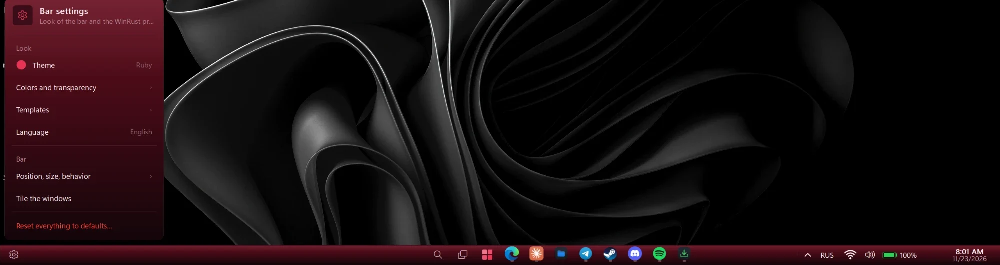
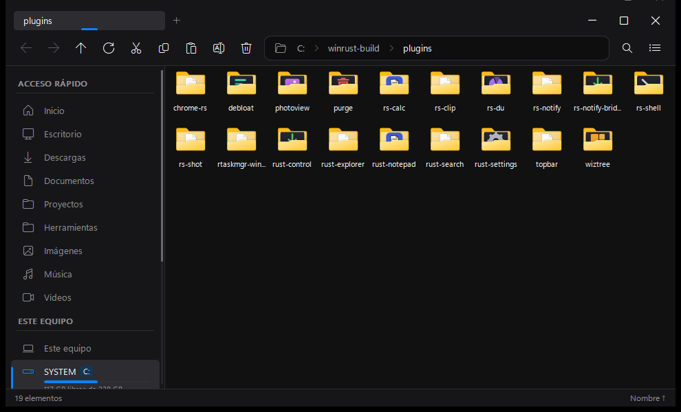

<p align="center"></p>

# WinRust

**Rust で書かれた Windows シェル: 標準のものより高速で軽量です。** Windows の一部 (タスクバー、エクスプローラー、ファイル検索、タスク マネージャー) を置き換える小さなネイティブプログラム (.NET なし、Electron なし) に加え、ディスククリーナー、ディスクマップ、フォトビューアーを提供します。1 つのインストーラーで導入でき、ボタン 1 つですべて取り除けます。

[English](README.md) | [Русский](README.ru.md) | **日本語**

<p align="center"></p>

> **最初にお読みください。** WinRust は Windows Search をオフにし、タスクバーを非表示にし、エクスプローラーをシェルとして使わないようにできます。exe はコード署名されていないため、SmartScreen が警告を表示します。インストール前に復元ポイントが作成されますが、まずは予備のマシンや VM で試してください。

## インストール

1. [最新リリース](https://github.com/Lemxy/WinRust/releases/latest)から `WinRust.exe` をダウンロードします (Windows 10/11、x64)。
2. 管理者として実行します。
3. 必要なコンポーネントにチェックを入れ、インストールボタンを押します。新規インストールでは `rust-explorer` のチェックは外れています。Windows エクスプローラーのシェルを置き換えるにはチェックを入れてください (または topbar の行にある歯車から **Shell: rust-explorer** スイッチを使います)。コンポーネントは正しい順序でインストールされます。失敗したものやスキップされたものがあっても他のものは止まらず、ウィンドウに問題の一覧が表示されます。

Windows Search は任意です。機能を削った Windows (たとえば Windows Search サービスのない、不要機能を除去した LTSC イメージ) では、インストールを失敗させる代わりに、その手順は警告付きでスキップされます。

UAC が**別の管理者**のパスワードを求めた場合でも、ユーザーごとの設定 (スタートアップ項目、スケジュールされたタスク、PowerShell プロファイル、検索の権限) は、入力した管理者ではなくサインイン中のユーザーに適用されます。インストーラーがそのユーザーを特定できない場合は、何も変更する前に停止します。

**アップデート:** リリースページから新しい `WinRust.exe` をダウンロードし、管理者として実行して、アップデートまたはインストールしたいコンポーネントを選択します。既存の `rust-explorer` はアップデート時にデフォルトで選択されたままになります。設定と、保存された元の Windows の値はそのまま残ります。

インストーラーは英語です。隅にある **Русский** ボタン (またはバーの右クリックメニューの "WinRust apps in Русский") で、すべての WinRust プログラムがロシア語に切り替わります。

## 削除

- インストーラーウィンドウの **Remove all** ですべてを元に戻せます: Windows Search、タスクバー、エクスプローラー、サービスが復元されます。
- プラグインを 1 つずつ削除する場合: `plugin-launcher uninstall <plugin>` ([コマンドライン](#コマンドライン)を参照)。
- **画面にタスクバーやデスクトップが表示されなくなった場合:** Ctrl+Alt+Del → タスク マネージャー → 新しいタスクの実行 → `explorer.exe` の順に操作し、インストーラーを実行して Remove all を押してください。

アンインストール時、`rust-explorer` はインストール前に保存したサービスのスタートアップ値と svchost のグループ化しきい値を復元します。これらのバックアップがない古いインストールでは現在の値が維持され、警告が表示されます。

## インストールされるもの

| プラグイン | 得られるもの | Windows での変更内容 |
|---|---|---|
| **rust-search** | すべての NTFS ドライブを対象とするファイル検索 (Alt+Space)。topbar があれば Win+R で実行モードが開きます: 履歴、フォルダーの補完 (Tab)、Ctrl+Shift+Enter で管理者として実行 | Windows Search サービスを無効にし、SearchHost.exe をブロックし、タスクバーの検索ボックスを非表示にします |
| **rtaskmgr-win32** | タスク マネージャー (Ctrl+Shift+Esc で開きます) | `taskmgr.exe` がこちらにリダイレクトされます (システムファイルには手を加えません)。**rs-du** ディスククリーナーもインストールします。**Speed** ページには、任意で有効にできる元に戻せるスイッチがあります: Game / Work プロファイル (バックグラウンドサービスの停止、ランチャーや同期アプリの終了と再起動)、メモリのスタンバイキャッシュのクリア (今すぐ、または topbar の実行中に自動で)、Windows のスタートメニュー、ウィジェット、Phone Link のプロセスのブロック、サードパーティのアップデーターの代わりに週 1 回の `winget upgrade`、ビルドキャッシュやゲームライブラリ向けの Defender 除外設定、NTFS の高速化 (最終アクセス時刻なし、8.3 形式の名前なし)、広告をブロックする hosts ファイル。**Startup** にはログオン/起動時のタスクとサードパーティの自動起動サービスも表示され、それぞれが直近の起動をどれだけ遅くしたかが分かります (Windows 自身の起動ログ)。**What's slow** はドライバーの時間 (DPC/割り込み)、応答しないウィンドウ、遅いディスク、起動時間を表示します。アンインストールですべて元に戻ります |
| **topbar** | Windows 11 風の下部バー: ウィンドウ、時計、音量、メニュー | 標準のタスクバーを非表示にします。**reshell** (ホットキー: Win+Ctrl+1/2/3 と Win+\` でデスクトップを切り替え (Win+1..9 でバーのアプリボタンを開く)、Win+D でデスクトップを表示、Win+I で設定を開く、Win+E でファイルマネージャーを開く。バーが停止した場合はタスクバーを元に戻します)、**rs-du**、PowerShell プロファイルへのブロック (`zoxide`、`grep`=rg、`ll`=eza、`cat`=bat。これらがなければ何もしません) もインストールします。歯車メニューには短いページがあります: Theme、Colors and transparency (バーと WinRust ウィンドウの任意の色、バーの不透明度)、Templates (独自の外観を保存して切り替え)、バー (下 / 左 / 右の端、サイズ、自動的に隠す、Windows 10 のように左端にボタン) と、すべてをデフォルトに戻すリセット |
| **rust-explorer** | タブ付きのファイルマネージャーとデスクトップ | フォルダーやドライブがこれで開きます。**エクスプローラーはシェルではなくなります** (topbar が失敗した場合は自動的に戻ります)。新規インストールでは、値をバックアップできる場合に、PcaSvc、InventorySvc、lfsvc、cbdhsvc、DoSvc のスタートアップ設定と svchost のグループ化しきい値を調整します。独自のコピー機能 (SSD では複数ファイルを同時に、大きなファイルはバッファなしで、進捗はステータス行に表示) と右クリックの **Compress to ZIP** (全コア) / **Extract here** (ZIP と 7z) を備え、ZIP エンジンも独自のものです。`.zip` はフォルダーのように開けます (閲覧、取り出しコピー、中のファイルを開く)。他のプログラムからの "Show in folder" でファイルが選択されます (ダウンロード、ドキュメント、デスクトップ、ピクチャ、ミュージック、ビデオ、ピン留めしたフォルダーなどの一般的なフォルダーでは、ウィンドウが開いていないときも)。マウスの戻る / 進むボタンが使えます。デスクトップを右クリックするとアイコンを非表示にできます。topbar が必要です |
| **wiztree** | ディスク使用量マップ (スタートの "WinRust Disk") | ファイルとショートカット以外は何も変更しません |
| **photoview** | 高速なフォトビューアー | 「プログラムから開く」に追加します (デフォルトにはなりません) |
| **rust-settings** | Rust 製の設定: ディスプレイ (解像度、リフレッシュレート)、サウンド (音量)、電源プランとドライブの空き容量、アプリごとの音量とデバイスの選択、夜間モード、ドラッグによるディスプレイの配置、ネットワークアダプター、すべてのアダプターでの Wi-Fi (パスワードまたは 802.1X)、VPN とプロキシ、Bluetooth、アプリ、Windows Update、ディスクのクリーンアップ、テーマ、バージョン情報 | ファイルとショートカット以外は何も変更しません。Win+I とバーのメニューで、Windows の設定の代わりにこのウィンドウが開きます (ごく一部のまれなページだけはシステムのものが開きます) |
| **debloat** | オフにするもの: テレメトリ、Copilot、Recall、スタートの広告、バックグラウンドの Edge | サービスとレジストリポリシー。古い値は保存され、アンインストール時に復元されます。**コマンドラインのみ:** `install debloat --yes` |
| **purge** | Tiny11 のように同梱の不要なアプリを削除します: Clipchamp、ニュース、天気、Xbox オーバーレイ、Teams、Cortana、ウィジェット、Skype など、さらにテレメトリのタスクも | **元に戻せません。取り消しはできません。** アプリはすべてのユーザーとイメージから削除されます。ストア、設定、スタート、ランタイムは残ります。まず `purge.exe` を実行してください: 一覧を表示するだけです。**コマンドラインのみ:** `install purge --yes` (OneDrive と Edge: `purge.exe --apply --onedrive --edge`) |
| chrome-rs | ブラウザー | まだインストールできません |

すべての変更は元に戻せます: アンインストールすると、変更前にあった値に戻ります。

## スタイル

バーの左端にある歯車で **Bar settings** が開きます。その **Theme** ページで選んだスタイルは、バー、ファイルマネージャー (rust-explorer)、検索ウィンドウ (Alt+Space) にすぐに適用されます:

| スタイル | 見た目 |
|---|---|
| **Normal** | Windows 11 のブルー、バーは下部 |
| **Terminal** | 黒地に緑、Consolas、角は四角 |
| **Floating dock** | 中央にピル型のバー。最大化したウィンドウは画面全体を使い、ドックはその上をスライドして隠れ、下端で再び現れます |
| **Tiling** | 上部に細いバー、アンバーのアクセント、Normal と同様の角丸。"Tile the windows" で開いているウィンドウを並べて配置します |
| **White road** | 明るいアイボリーにゴールド: バー、そのパネル、rust-settings の背景に、一部がゴールドで縁取られた淡いローポリの三角形 |
| **Ruby** | 鮮やかなルビーのアクセントを持つ深いガーネット: バーとそのパネルの背景に、柔らかな光沢のある上から下への滑らかなグラデーション |

歯車メニューでは、バーの位置 (下、左、右: サイドバーではアイコンのみが表示され、パネルはその横に開きます) と自動的に隠す設定もできます。

選択内容は `%ProgramData%\WinRust\style.txt` に保存されます。

## ベンチマーク

1 台のマシン (Windows 11 IoT Enterprise 10.0.26300、RTX 4060 Laptop、NTFS) での 1 回限りの測定です。実験室の数値ではなく、桁の目安として扱ってください。

| 項目 | Windows | WinRust | 差 |
|---|---|---|---|
| ファイル検索 (C: 全体を対象とする rust-search と、1 つのフォルダーを対象とする `dir /s`) | 8,340 ms | 45 ms | **99.5%** 高速 |
| 同上、`Get-ChildItem -Recurse` との比較 | 16,200 – 28,600 ms | 45 ms | **99.7–99.8%** 高速 |
| フォルダーウィンドウを開く (rust-explorer、5 回の中央値) | 420 ms | 60 ms | **86%** 高速 |
| シェルのメモリ (topbar + rust-explorer + rs-shell + reshell と explorer.exe) | 366 MB | 46 MB | **87%** 少ない |
| 同上、検索インデックス (53 MB) を含む | 366 MB | 99 MB | **73%** 少ない |
| ファイルマネージャーのバイナリサイズ (現在は ZIP と 7z を内蔵) | 3,280 KB | 1,179 KB | **64%** 小さい |
| タスク マネージャーのバイナリサイズ | 5,791 KB | 954 KB | **84%** 小さい |
| バーのアイドル時 CPU (最適化後の topbar、1 コアに対する %) | 0.00–0.10% (explorer) | 0.05–0.10% | Explorer と同等 |
| 小さなファイル 5,000 個、約 160 MB のコピー (rust-explorer: Explorer のエンジンである IFileOperation と独自のコピー機能) | 16.3 s | 2.3 s | **86%** 高速 (7 倍) |
| 1 GB のファイル 1 つのコピー (同上) | 0.58 s | 0.60 s | 同等 |
| 同じ 5,000 ファイルを ZIP に圧縮 (`Compress-Archive` と rust-explorer の Compress to ZIP) | 48.4 s | 0.75 s | **98%** 高速 (64 倍) |

要するに: **サイズ/速度のテストでは 64–99% 高速または小さく、アイドル時 CPU と大きなファイル 1 つのコピーでは同等です。** 注意点: rs は作成済みの MFT インデックスを検索する (そのために 53 MB のメモリを使う) のに対し、`dir` と PowerShell はディスクを一から走査します。テスト中も explorer.exe はウィンドウを開いたまま動作していたため、メモリの削減量はやや大きく見積もられています。Windows Search と標準のタスク マネージャーは比較していません。コピーと ZIP の測定 (`cargo test -p rust-explorer --release bench -- --ignored`) は、書き込んだ直後のデータに対する 1 回だけの実行で、両者ともメモリキャッシュから読み込んでいます。各ファイルをそれぞれのコアで個別に圧縮するため、こちらの ZIP はやや大きくなりました (0.9 MB と 0.7 MB)。

## スクリーンショット

**タスクバー**




**タスク マネージャー** (ロシア語 UI)


**ファイルマネージャー**



---

## 開発者向け

### 構成
```
src/            the installer (plugin-launcher.exe)
  main.rs         the plugin table PLUGINS: name, texts, install/uninstall pair, icon
  install/        what each plugin changes and how it is undone (one file per plugin)
  cli.rs, ui.rs   the command line and the window; both call the same install functions
common/         winrust-common: language switch (t!/tf!), UI styles and palettes, reg.exe output parser, NTFS MFT reader
plugins/        sources of every plugin, each its own crate
ReShell/        reshell (desktop hotkeys, topbar safety net), ships with topbar
payload.txt     the exes embedded into the installer, and where the build puts them
payload/        those exes once built (not in git)
scripts/        build, update, release
```
すべてが 1 つの cargo ワークスペースです (`Cargo.lock` は 1 つ、すべての exe は `target\release` に出力)。`plugins/rust-search` と `plugins/chrome-rs` は `panic = "unwind"` が必要なため、別々にビルドします (`Cargo.toml` を参照)。

### ビルド
Windows x64 と、MSVC ツールチェーン付きの Rust stable (1.85 以上) が必要です。
```powershell
powershell -ExecutionPolicy Bypass -File scripts\build-all.ps1
```
結果: すべてのプラグインを内蔵した `target\release\plugin-launcher.exe`。実行中のインストーラーは先に閉じてください。テスト: `cargo test --workspace` (と `plugins\rust-search` での `cargo test`)。CI はプッシュのたびに同じものを実行します (`.github/workflows/build.yml`)。

| スクリプト | 内容 |
|---|---|
| `build-all.ps1` | すべて: プラグイン → `payload\` → インストーラー |
| `build-plugins.ps1` | プラグインのみ → `payload\` (インストーラーは再ビルドしない) |
| `update-plugin.ps1 <plugin>` | インストーラーを再ビルドせずに、インストール済みのプラグインを 1 つ再ビルドして再インストールします (UAC で管理者権限を求めます) |
| `user-mode.ps1`, `dev-update.ps1` | 開発者モード: topbar、rust-explorer、rs-shell、reshell を Explorer の上で `%LOCALAPPDATA%` から実行し、管理者権限なしで入れ替えます |
| `bench.ps1` | 検索とタスク マネージャーのベンチマーク |
| `publish.ps1`, `release.ps1` | コミットとプッシュ。`WinRust.exe` を含む GitHub リリース |

### コマンドライン
**管理者権限のある**ターミナルから:
```
plugin-launcher list
plugin-launcher install <plugin>... --yes (one or more names, or `all` for the default components; without --yes it only prints warnings)
plugin-launcher update <plugin>          (reinstall from payload\ next to the exe)
plugin-launcher uninstall <plugin>
plugin-launcher rollback --yes           (remove everything)
```

新規の一括インストールに `rust-explorer` を含めるには、`plugin-launcher install all rust-explorer --yes` を実行します。`topbar` がすでにインストールされていれば、`rust-explorer` を単独でインストールできます。
1 つのコマンドで複数のプラグインを指定すると、テーブルの順序でインストールされます (topbar は rust-explorer より前)。1 つが失敗しても残りは止まりません。終了コード: 0 は成功、1 はエラー (少なくとも 1 つのプラグインが失敗)、2 は引数の誤りまたは `--yes` なし。引数なしで実行するとウィンドウが開きます。インストールログ: `%ProgramData%\plugin-launcher\install.log`。

### プラグインの追加
1. `plugins/<name>` にクレートを作成し、ルートの `Cargo.toml` の `members` に追加します。
2. `payload.txt` に 1 行追加します。
3. install/uninstall のペアを持つ `src/install/<name>.rs` を作成します (`src/install/mod.rs` に `mod` の行も追加)。アンインストールで元に戻せるよう、何かを変更する前に元の値を保存してください。
4. `PLUGINS` (`src/main.rs`) にエントリーを追加します。ウィンドウ、その高さ、コマンドラインは自動的にそれを認識します。

## ライセンス

[MIT](LICENSE-MIT) または [Apache-2.0](LICENSE-APACHE) のいずれかを選択してライセンスされます。
