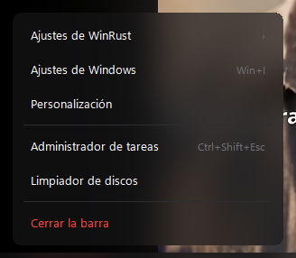
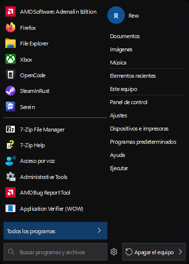
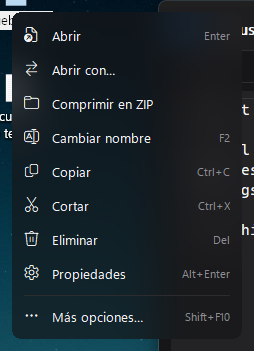
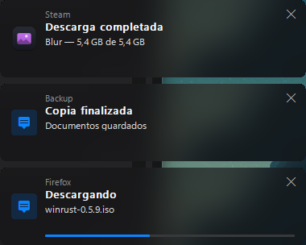
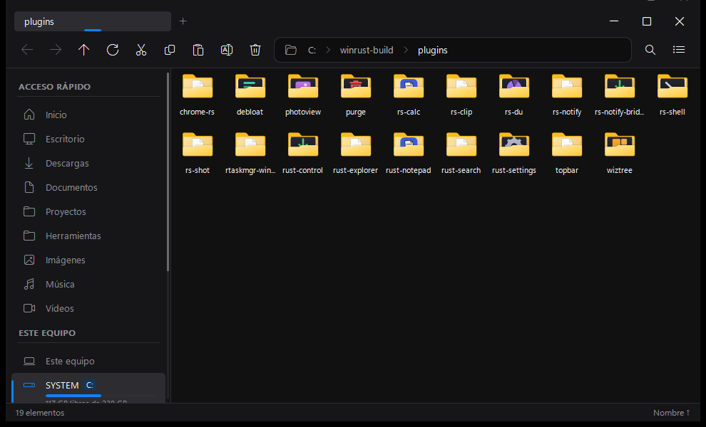
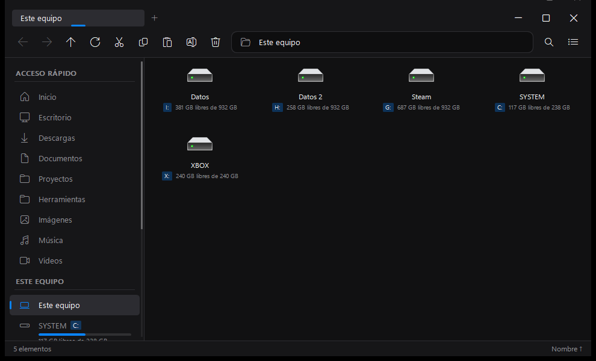
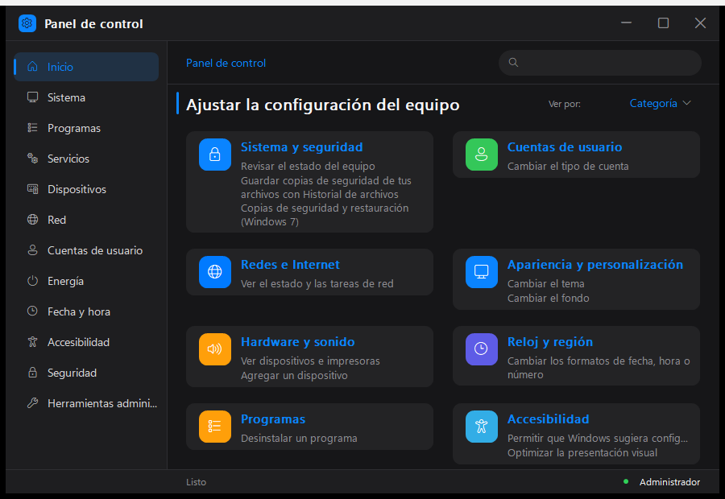

# WinRust — my custom shell

<p align="center">
  
</p>

<p align="center">
  <b>A Windows shell replacement, tuned for one machine.</b><br>
  Real blur, three Start menu styles, a file manager, a Control Panel, notifications and a shell that never starts Explorer.
</p>

<p align="center">
  <a href="#screenshots">Screenshots</a> ·
  <a href="#what-this-fork-adds">What this fork adds</a> ·
  <a href="#replacing-windows-explorer">Replacing Explorer</a> ·
  <a href="#build">Build</a> ·
  <a href="#performance">Performance</a> ·
  <a href="#roadmap">Roadmap</a>
</p>

---

This is a personal fork of [**Lemxy/WinRust**](https://github.com/Lemxy/WinRust): the upstream project already rebuilds the
taskbar, the file manager, the file search and Task Manager in Rust. On top of it this fork adds the look and the pieces I
wanted for a daily-driver machine — every change is documented in [FORK-CHANGES.md](FORK-CHANGES.md), and what is still
missing lives in [PENDING.md](PENDING.md).

> Screenshots are from a real session (1360×768 + 1440×900, Spanish UI, `rs-shell` as the shell, no `explorer.exe`).

## Screenshots

### The bar


A real blurred backdrop (screen capture + box blur + tint, refreshed while it is visible), the tray hugging the clock, the
bell for notifications and no hairline border. Right-click it for the bar menu:



**Dodge windows** (**Settings → Taskbar → Behavior → Dodge windows**, `dodge.txt`): the bar reserves no work area,
slides away as soon as a window of its monitor reaches it (a maximized window, a video, one dragged to the edge) and comes
back when the pointer touches that screen's edge. Already-maximized windows grow to the whole screen at once. It works
independently of *Hide automatically*, and per monitor: a window on one screen only moves that screen's bar, focused or
not, and each screen's edge brings back only its own bar.

### One bar per monitor


`bar-monitor=all` in `look.txt` (or **Settings → Bar → Monitor → All screens**) puts a bar on every monitor: each one
paints its own blur, buttons, pins and clock; the tray icons and the keyboard hook stay on the leader (the primary bar),
and only the primary reserves work area (Windows' `SPI_SETWORKAREA` is a single global rect). Popups open on the monitor
of the bar that was clicked.

### Start



Windows 7, Windows 10 and Windows 11 styles (this is the Windows 10 one), pinned apps, independent hover per column, wheel
scrolling, right-click on a tile (open, run as administrator, **uninstall**, pin), adjustable position and size.

### Context menu



The desktop and file menus are ours: frosted, rounded, with icons, shortcuts and one submenu level. A file gets
"Abrir con…" (our own centred picker, with a Browse button) and "Más opciones…" opens the native shell menu for the verbs
we do not cover.

### Notifications




Toasts with the same frost as the menus, a three-toast stack, a progress variant and a centre with the history. Any program
can raise one: write a `NotifyWire` to `\\.\pipe\winrust-notify`, or use the `rs-notify` helper:

```bat
rs-notify --app "Backup" --title "Copy finished" --body "Documents backed up" --icon "C:\Program Files\App\app.exe"
rs-notify --app "Download" --title "Downloading" --body "Windows.iso" --progress 0.42 --id download
```

### File manager





Tabs in the title bar, **This PC** with every drive as its own cell (letter tag + free space), a 48 px icon grid as the
default view, a scrollable left pane with Quick access / This PC / Removable devices / Network / Recycle Bin, Quick access
that can be pinned, unpinned, reordered by drag and drop, a Recycle Bin view with Restore and Empty, and a delete path that
reports the real error when the shell cannot recycle.

### Control Panel



A Control Panel written in Rust, following the project's look: the classic **Category** home page, the same eight
categories, each link opening a real page in the app or delegating to `ms-settings:` when Windows owns it. Pages for
System, Programs, Services, Devices, Network, Users, Power, Date/Time, Accessibility, Security and admin tools.

### Task Manager


Half the size of the Windows one, smaller fonts, Mica-style frost and opaque rows.

## What this fork adds

- **Real blur** behind the bar, the menus and the panels (not translucency): the desktop behind the rect is captured,
  blurred and painted with a tint; `bar-blur`, `bar-radius`, `menu-alpha`, `menu-blur`, `menu-radius` in
  `%ProgramData%\WinRust\look.txt`.
- **Three Start menu styles** (`start7.rs`, `start10.rs`, `start11.rs`), position (left / centred) and size (90 / 100 / 115 %).
- **Windows 11 style context menus** with icons, shortcuts, ticks, one submenu level and live transparency, instead of
  `TrackPopupMenu`.
- **Tabbed settings window** instead of a long dropdown, double-buffered, with the frost background.
- **Spanish** across the shell (`common/es.tsv`, English is the key, missing entries fall back to English) plus the
  existing EN/RU/JA/PT/ZH UI; `tools/i18n-check.ps1` audits coverage, placeholders and duplicates.
- **Windows' own icons** for Explorer/Settings and sharp shell icons everywhere: `common::icon` takes the jumbo 256 px
  asset and scales it down with an alpha-aware area average.
- **Notifications** with a named pipe and `rs-notify`, a bell with an unread dot and a notification centre.
- **Control Panel** in Rust (new crate, `plugins/rust-control`).

## Replacing Windows Explorer

Phase 1 (`tools/explorer-edge.ps1`) froze the stock Explorer and removed Edge. Phase 2 (`tools/shell-phase2.ps1`) makes
the replacement real:

- `rs-shell.exe` is this user's shell (`HKCU\...\Winlogon\Shell`); the `rs-overlay` logon task is disabled, so
  **Explorer never starts at logon**. `rs-shell` starts the bar, the desktop, the Run keys and Win+D / Win+E, and hands the
  session back to Explorer if the bar will not stay up.
- The shell pieces WinRust replaces cannot start: `StartMenuExperienceHost`, `SearchApp`, `SearchUI`, `SearchHost`,
  `Widgets`, `Cortana` and `ShellExperienceHost` (`Image File Execution Options` → `cmd.exe /c exit`).
- Windows Search is disabled (`rs-search` replaces it); folders open in `rust-explorer` through
  `HKCU\Software\Classes\Directory|Folder\shell\open\command`; `explorer.exe` itself stays available for
  "show in folder" and URL/Settings hand-offs.
- Everything is reversible: both scripts keep their original values under `tools\state\` and support `-Restore`.

## Build

Most crates build with the GNU toolchain:

```bat
cargo +stable-x86_64-pc-windows-gnu build --workspace --exclude plugin-launcher --release
```

`rtaskmgr-win32` must be built with MSVC (its GNU build fails to load with `0xC0000139`):

```bat
cargo +stable-x86_64-pc-windows-msvc build -p rtaskmgr-win32 --release
```

The installer (`plugin-launcher`) embeds the built exes listed in `payload.txt`; populate `payload\` with
`scripts\build-plugins.ps1` before building it.

## Configuration

`%ProgramData%\WinRust\look.txt` (edited from the bar's settings window):

```ini
bar-blur=1
bar-radius=14
menu-alpha=67
menu-blur=1
menu-radius=18
start-left=1
start-scale=0
start-style=1
notify=1
notify-timeout=5
```

`lang.txt` holds the language code (`es` for Spanish). Window frost (`win-blur`) stays off by default: on bright wallpapers
the tint needed for readable text washes the window out.

## Performance

Measured on this machine (Ryzen 5 5500, 32 GB, two displays) with `scripts\metrics.ps1`; every row, the method and the
exact conditions are in [docs/PERFORMANCE.md](docs/PERFORMANCE.md). Re-run the script to refresh both:

```powershell
powershell -ExecutionPolicy Bypass -File scripts\metrics.ps1
```

**The whole shell, idle** — bar, desktop, supervisor, clipboard helper and hotkeys — costs **101.9 MB** and **3 % of one
core** (0.25 % of this 12-thread CPU). The bar is the expensive part: it holds the blurred backdrop of every monitor.
Setting `bar-blur=0` (or `menu-blur=0`) in `%ProgramData%\WinRust\look.txt` trades the frost for ~0 %.

| Process | RAM (idle) | CPU (idle, 1 core) |
|---|---:|---:|
| Bar (`topbar`) | 49.8 MB | 3.00 % |
| Desktop (`rust-explorer --desktop`) | 30.2 MB | 0.00 % |
| Supervisor (`rs-shell`) | 8.0 MB | 0.00 % |
| Clipboard helper (`rs-clip`) | 7.4 MB | 0.00 % |
| Desktop hotkeys (`reshell`) | 6.5 MB | 0.00 % |
| **Total** | **101.9 MB** | **3.00 %** |

**Opening an app** — median of 3, `CreateProcess` to the first visible frame — and what it holds while idle:

| App | Window visible | RAM (idle) |
|---|---:|---:|
| `rs-calc` | 17 ms | 19.7 MB |
| `rust-control` (Control Panel) | 29 ms | 19.7 MB |
| `rtaskmgr-win32` (Task Manager) | 29 ms | 34.7 MB |
| `photoview` | 30 ms | 18.3 MB |
| `rust-notepad` | 30 ms | 22.9 MB |
| File manager (new window) | 77 ms | 29.1 MB |
| `rust-settings` | 136 ms | 30.9 MB |

**UI and I/O**:

| Operation | Latency |
|---|---:|
| Open the Start menu | 35 ms |
| Open the bar menu (right click) | 26 ms |
| Open the notification centre | 31 ms |
| Raise a notification (`rs-notify`, median of 10) | 9.0 ms |
| Search the whole `C:` (`rs.exe winrust`, 101 hits) | 16 ms |
| Supervisor brings the bar back after a kill | 5.3 s |
| …and the desktop | 2.3 s |

The 16 programs on disk add up to **10.6 MB**; the installer with all of them embedded is **13.5 MB**.
Windows Search is not in the table because `rust-search` turns the WSearch service off: the comparison is on the
`rust-search` page, where a full-drive scan is ~3 orders of magnitude slower.

## Roadmap

- **Multi-monitor**: bar per monitor, flyouts/toasts anchored to their monitor, per-monitor DPI, hotplug. Full review in
  [tools/multimonitor-review.md](tools/multimonitor-review.md).
- **Native notifications bridge**: Discord/Steam/Serein post WinRT toasts, which need Explorer's toast host; a small
  package-identity listener (`UserNotificationListener`) forwarding them to `\\.\pipe\winrust-notify` is the next step.
- **Wallpaper Engine**: how WE attaches to `Progman`/`WorkerW` and the plan to support it in a custom shell:
  [tools/wallpaper-engine.md](tools/wallpaper-engine.md).

## Credits and license

Built on [Lemxy/WinRust](https://github.com/Lemxy/WinRust) (the original README is kept as
[README.upstream.md](README.upstream.md)). Same license as upstream (MIT / Apache-2.0, see `LICENSE-MIT` and
`LICENSE-APACHE`).
