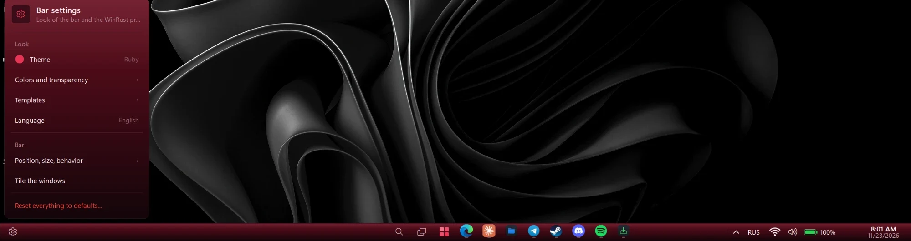
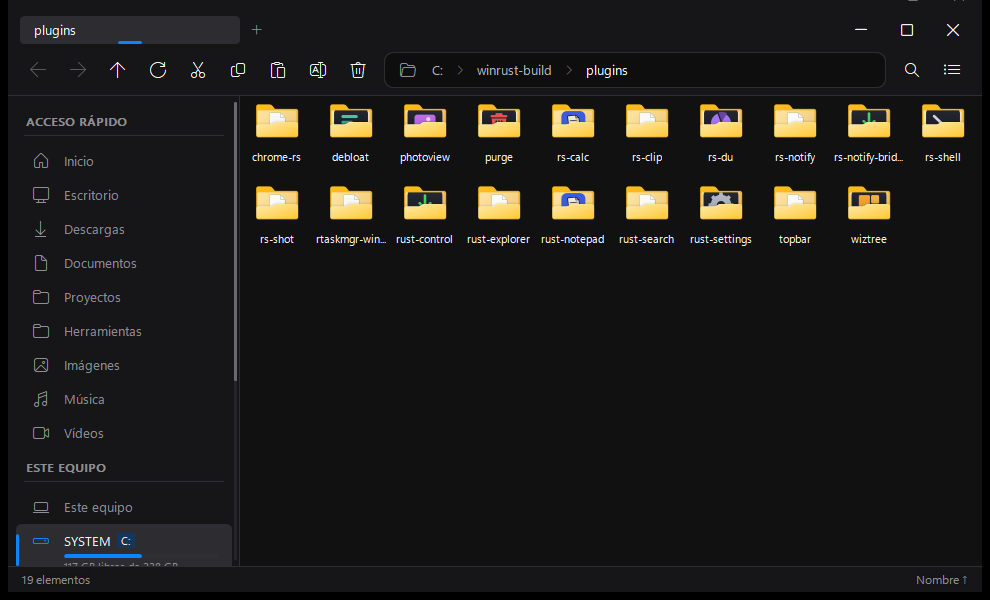

 <p align="center"></p>

# WinRust

**Um shell para Windows escrito em Rust: mais rápido e leve que o shell original.** Pequenos programas nativos (sem .NET ou Electron) que substituem partes do Windows: barra de tarefas, Explorador de Arquivos, pesquisa de arquivos e Gerenciador de Tarefas, além de um limpador de disco, um mapa de uso do disco e um visualizador de fotos. Um único instalador instala todos os componentes, e um único botão remove tudo.

Português | [English](README.md) | [Русский](README.ru.md)

<p align="center"></p>

> **Leia isto primeiro.** O WinRust desativa o Windows Search, oculta a barra de tarefas e pode desativar o Explorer como shell do sistema. O executável não possui assinatura digital de código, portanto, o SmartScreen exibirá um aviso. Um ponto de restauração é criado antes da instalação, mas recomendamos testá-lo primeiro em uma máquina secundária ou em uma máquina virtual.

## Instalação

1. Baixe o `WinRust.exe` na [versão mais recente](https://github.com/Lemxy/WinRust/releases/latest) (Windows 10/11, x64).
2. Execute-o como administrador.
3. Clique em **Install WinRust**. Todos os componentes serão instalados na ordem correta.

**Atualização:** baixe o novo `WinRust.exe` na página de versões, execute-o como administrador e clique em **Update WinRust**. Os plugins instalados serão atualizados e os ausentes serão instalados. Suas configurações e os valores originais salvos do Windows serão preservados.

O instalador está em inglês. O botão **Русский**, localizado no canto da janela (ou a opção "WinRust apps in Русский" no menu de contexto da barra), altera todos os programas do WinRust para russo.

## Remoção

- **Remove all:** na janela do instalador, desfaz todas as alterações. O Windows Search, a barra de tarefas, o Explorer e os serviços são restaurados.
- Um plugin por vez: `plugin-launcher uninstall <plugin>` (consulte [Linha de comando](#linha-de-comando)).
- **Se a tela ficar sem barra de tarefas ou área de trabalho:** pressione Ctrl+Alt+Del → Gerenciador de Tarefas → Executar nova tarefa → `explorer.exe`. Em seguida, execute o instalador e clique em Remove all.

## O que é instalado

| Plugin             | O que você recebe                                                                                  | O que ele altera no Windows                                                                                                                                                                                                                                                                                                                                                                                                                                        |
| ------------------ | -------------------------------------------------------------------------------------------------- | ------------------------------------------------------------------------------------------------------------------------------------------------------------------------------------------------------------------------------------------------------------------------------------------------------------------------------------------------------------------------------------------------------------------------------------------------------------------ |
| **rust-search**    | Pesquisa de arquivos em todas as unidades NTFS, com Alt+Space                                      | Desativa o serviço Windows Search, bloqueia o SearchHost.exe e oculta a caixa de pesquisa da barra de tarefas                                                                                                                                                                                                                                                                                                                                                      |
| **rtaskmgr-win32** | Gerenciador de Tarefas (Ctrl+Shift+Esc o abre)                                                     | Redireciona `taskmgr.exe` para o novo gerenciador (o arquivo original do sistema permanece intacto). Também instala o limpador de disco **rs-du**                                                                                                                                                                                                                                                                                                                  |
| **topbar**         | Uma barra inferior no estilo do Windows 11: janelas, relógio, volume e menus                       | Oculta a barra de tarefas original. Também instala o **reshell** (atalhos: Win+1/2/3 e Win+\` alternam entre áreas de trabalho; Win+D mostra a área de trabalho; Win+I abre as Configurações; Win+E abre o gerenciador de arquivos; restaura a barra de tarefas caso a barra personalizada pare de funcionar), o **rs-du** e um bloco no perfil do PowerShell (`zoxide`, `grep`=rg, `ll`=eza, `cat`=bat; não faz nada se esses programas não estiverem instalados) |
| **rust-explorer**  | Um gerenciador de arquivos com abas e área de trabalho                                             | Pastas e unidades são abertas nele; **o Explorer deixa de ser o shell do sistema** (é restaurado automaticamente caso o topbar falhe). Desativa PcaSvc, InventorySvc, lfsvc e cbdhsvc, define DoSvc como manual e agrupa processos svchost. Requer o topbar                                                                                                                                                                                                        |
| **wiztree**        | Um mapa de utilização do disco ("WinRust Disk" no menu Iniciar)                                    | Nada, além da instalação do arquivo e de um atalho                                                                                                                                                                                                                                                                                                                                                                                                                 |
| **photoview**      | Um visualizador de fotos rápido                                                                    | Adiciona o programa à opção "Abrir com" (ele não se torna o aplicativo padrão)                                                                                                                                                                                                                                                                                                                                                                                     |
| **debloat**        | Desativa telemetria, Copilot, Recall, anúncios do menu Iniciar e execução do Edge em segundo plano | Altera serviços e políticas do Registro; os valores anteriores são salvos e restaurados durante a desinstalação. **Somente pela linha de comando:** `install debloat --yes`                                                                                                                                                                                                                                                                                        |
| chrome-rs          | Um navegador                                                                                       | Ainda não pode ser instalado                                                                                                                                                                                                                                                                                                                                                                                                                                       |

Todas as alterações são reversíveis: a desinstalação restaura os valores que existiam antes.

## Estilos

A engrenagem na extremidade esquerda da barra abre a opção **Style**. A escolha é aplicada imediatamente à barra, ao gerenciador de arquivos (rust-explorer) e à janela de pesquisa (Alt+Space):

| Estilo            | Aparência                                                                                                                                                       |
| ----------------- | --------------------------------------------------------------------------------------------------------------------------------------------------------------- |
| **Normal**        | Azul do Windows 11, com a barra na parte inferior                                                                                                               |
| **Terminal**      | Verde sobre preto, fonte Consolas e cantos quadrados                                                                                                            |
| **Floating dock** | Barra em formato de cápsula no centro da tela; janelas maximizadas ocupam a tela inteira, enquanto o dock desliza para fora delas e retorna pela borda inferior |
| **Tiling**        | Barra fina na parte superior, destaque em âmbar e cantos quadrados; a opção "Tile the windows" organiza as janelas abertas lado a lado                          |

A escolha é armazenada em `%ProgramData%\WinRust\style.txt`.

## Benchmark

Medições pontuais realizadas em uma única máquina (Windows 11 IoT Enterprise 10.0.26300, RTX 4060 Laptop, NTFS). Considere os resultados como ordens de grandeza, não como medições laboratoriais.

| Teste                                                                             | Windows               | WinRust    | Diferença                  |
| --------------------------------------------------------------------------------- | --------------------- | ---------- | -------------------------- |
| Pesquisa de arquivos (rust-search em toda a unidade C: vs. `dir /s` em uma pasta) | 8.340 ms              | 45 ms      | **99,5% mais rápido**      |
| Mesmo teste vs. `Get-ChildItem -Recurse`                                          | 16.200 – 28.600 ms    | 45 ms      | **99,7–99,8% mais rápido** |
| Abertura de uma janela de pasta (rust-explorer, mediana de 5 execuções)           | 420 ms                | 60 ms      | **86% mais rápido**        |
| Memória do shell (topbar + rust-explorer + rs-shell + reshell vs. explorer.exe)   | 366 MB                | 46 MB      | **87% menos memória**      |
| Mesmo teste, incluindo o índice de pesquisa (53 MB)                               | 366 MB                | 99 MB      | **73% menos memória**      |
| Tamanho do executável do gerenciador de arquivos                                  | 3.280 KB              | 498 KB     | **85% menor**              |
| Tamanho do executável do gerenciador de tarefas                                   | 5.791 KB              | 869 KB     | **85% menor**              |
| Uso de CPU em repouso da barra (topbar após otimização, % de um núcleo)           | 0,00–0,10% (explorer) | 0,05–0,10% | Equivalente ao Explorer    |

Em resumo: **85–99% mais rápido ou menor em todos os testes de tamanho e velocidade, com consumo de CPU em repouso equivalente.**

Observações: o rs pesquisa em um índice MFT previamente preparado (o que consome 53 MB de memória), enquanto `dir` e o PowerShell percorrem o disco desde o início; o explorer.exe continuou em execução com suas janelas abertas durante o teste, portanto, a economia de memória está ligeiramente superestimada; o Windows Search e o Gerenciador de Tarefas original não foram comparados.

## Capturas de tela

**Barra de tarefas**




**Gerenciador de Tarefas** (interface em russo)


**Gerenciador de arquivos**



---

## Para desenvolvedores

### Estrutura do projeto

```text
src/            o instalador (plugin-launcher.exe)
  main.rs         a tabela de plugins PLUGINS: nome, textos, pares de instalação/desinstalação e ícone
  install/        o que cada plugin altera e como essas alterações são desfeitas (um arquivo por plugin)
  cli.rs, ui.rs   a linha de comando e a janela; ambos chamam as mesmas funções de instalação
common/         winrust-common: alternância de idioma (t!/tf!), estilos e paletas da interface, analisador da saída do reg.exe, leitor MFT do NTFS
plugins/        código-fonte de cada plugin, cada um em seu próprio crate
ReShell/        reshell (atalhos da área de trabalho e mecanismo de segurança do topbar), distribuído com o topbar
payload.txt     executáveis incorporados ao instalador e seus locais de destino durante o build
payload/        esses executáveis após a compilação (não incluídos no Git)
scripts/        compilação, atualização e publicação
```

Tudo faz parte de um único workspace do Cargo (um único `Cargo.lock`, todos os executáveis em `target\release`). `plugins/rust-search` e `plugins/chrome-rs` são compilados separadamente porque precisam de `panic = "unwind"` (consulte `Cargo.toml`).

### Compilação

Requer Windows x64, Rust stable (1.85+) com a toolchain MSVC.

```powershell
powershell -ExecutionPolicy Bypass -File scripts\build-all.ps1
```

Resultado: `target\release\plugin-launcher.exe`, contendo todos os plugins. Feche primeiro qualquer instalador que esteja em execução. Testes: `cargo test --workspace` (e `cargo test` em `plugins\rust-search`). A CI executa os mesmos testes a cada push (`.github/workflows/build.yml`).

| Script                            | O que faz                                                                                                                                                                          |
| --------------------------------- | ---------------------------------------------------------------------------------------------------------------------------------------------------------------------------------- |
| `build-all.ps1`                   | Tudo: plugins → `payload\` → instalador                                                                                                                                            |
| `build-plugins.ps1`               | Apenas os plugins → `payload\` (sem recompilar o instalador)                                                                                                                       |
| `update-plugin.ps1 <plugin>`      | Recompila e reinstala um plugin instalado sem recompilar o instalador (solicita privilégios de administrador via UAC)                                                              |
| `user-mode.ps1`, `dev-update.ps1` | Modo de desenvolvimento: executa topbar, rust-explorer, rs-shell e reshell a partir de `%LOCALAPPDATA%`, sobre o Explorer, permitindo alterná-los sem privilégios de administrador |
| `bench.ps1`                       | Benchmark da pesquisa e do Gerenciador de Tarefas                                                                                                                                  |
| `publish.ps1`, `release.ps1`      | Realizam commit e push; criam uma versão no GitHub com o `WinRust.exe`                                                                                                             |

### Linha de comando

Execute em um terminal **com privilégios de administrador**:

```text
plugin-launcher list
plugin-launcher install <plugin> --yes   (sem --yes, apenas exibe o aviso e não altera nada)
plugin-launcher update <plugin>          (reinstala a partir do payload localizado ao lado do executável)
plugin-launcher uninstall <plugin>
plugin-launcher rollback --yes           (remove tudo)
```

Códigos de saída: 0 para sucesso, 1 para erro, 2 para argumentos inválidos ou ausência de `--yes`. Sem argumentos, a janela é aberta. Log de instalação: `%ProgramData%\plugin-launcher\install.log`.

### Adicionando um plugin

1. Crie um crate em `plugins/<name>` e adicione-o à lista `members` no `Cargo.toml` raiz.
2. Adicione uma linha ao arquivo `payload.txt`.
3. Crie `src/install/<name>.rs` com as funções de instalação e desinstalação (e uma linha `mod` em `src/install/mod.rs`). Salve os valores originais antes de modificá-los, para que a desinstalação possa restaurá-los.
4. Adicione uma entrada à tabela `PLUGINS` (`src/main.rs`). A janela, sua altura e a linha de comando reconhecerão o novo plugin automaticamente.
